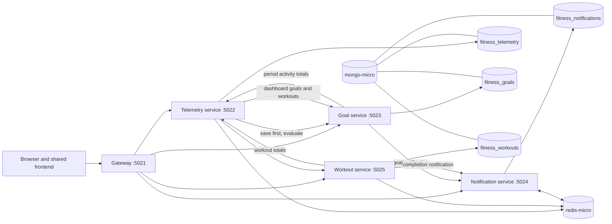

# Microservices architecture

## Components and request flow

The gateway serves `Frontend_Shared/`, adds an `X-Request-Id` when needed, and routes the existing public paths without changing the frontend. The internal goal path is synchronous: telemetry persists steps, goal evaluation reads the telemetry service's aggregate endpoint, and the goal service asks the notification service to save and publish a reached-goal notification. Errors in goal evaluation or notification delivery do not undo saved telemetry or fail the steps request.

The workout service owns workout documents. On stop, it saves the result, calculates and caches recommendations, then calls telemetry to add a unique workout contribution. Telemetry merges that contribution into its dashboard read model and evaluates goals. A retry of the totals request is safe because `workoutId` is unique in telemetry's database. The notification service owns all notifications and SSE connections; Redis Pub/Sub lets a replica publish to the replica holding a user's stream.

## Database ownership

All four databases live in the `mongo-micro` container, but each service connects only to its own logical database:

| Service | Database |
|---|---|
| Telemetry | `fitness_telemetry` |
| Goal | `fitness_goals` |
| Notification | `fitness_notifications` |
| Workout | `fitness_workouts` |

No service imports another service's source or reads its database. Cross-service data is obtained through HTTP APIs. `Microservices/scripts/check-databases.js` checks the Compose URIs and rejects relative imports that cross a service boundary. Redis is also dedicated to this variant and holds dashboard/recommendation cache entries and the `notifications` Pub/Sub channel.

## Coupling

Counts are static counts of distinct service callers and callees in the implemented HTTP call graph. The gateway's public caller is counted as one incoming dependency; Redis and MongoDB are not counted as services.

| Component | Afferent (callers) | Efferent (targets) |
|---|---:|---:|
| Gateway | 1 (browser) | 4 |
| Telemetry | 3 (gateway, goal, workout) | 2 (goal, workout) |
| Goal | 2 (gateway, telemetry) | 2 (telemetry, notification) |
| Notification | 3 (gateway, goal, workout) | 0 HTTP services |
| Workout | 2 (gateway, telemetry) | 2 (telemetry, notification) |

The notification service also depends on Redis Pub/Sub, and the telemetry and workout services depend on Redis for cache operations. These are infrastructure dependencies, not HTTP edges.

## Characteristics and limits

- Independent services and databases make the ownership boundary explicit and allow goal evaluation to scale separately.
- Synchronous calls make the ingest sequence and error handling easy to follow, but add network latency and operational failure points.
- The gateway hides internal service locations from the frontend. Docker DNS is resolved on new, non-keep-alive connections so newly scaled goal replicas can receive traffic.
- `NotificationHub` uses Redis Pub/Sub for cross-replica delivery; Redis loss can interrupt live delivery even when notification records have been saved.
- The five application CPU limits are 0.10 + 0.25 + 0.35 + 0.20 + 0.10 = 1.00. MongoDB and Redis are reported separately and have no explicit Compose memory caps.
- These are code-based characteristics. No performance, scale-out, fault-recovery, or browser result is claimed here.
