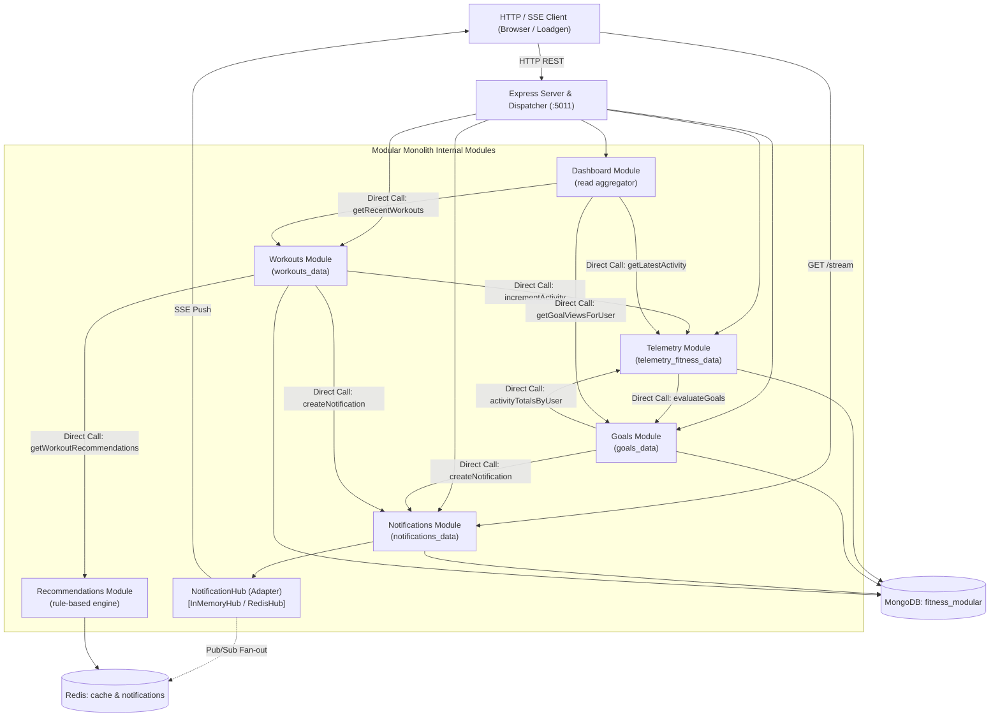

# Modular Monolith Architecture

Author: Suhas (Modular Monolith Lead)

## 1. Overview and Mermaid Diagram

The Modular Monolith variant packages the entire application into a single deployable Express service running on port 5011, while maintaining strict architectural boundaries across six business domains. Unlike the Event-Driven variant which coordinates through an event bus, modules in the Modular Monolith communicate via **direct function calls to module facades (`index.js`)**.

---

## 2. The Six Modules and Public Facades

| Module | Owned Collections | Public API (`index.js`) | Responsibilities |
|---|---|---|---|
| **`telemetry`** | `telemetry_fitness_data` | `saveStepData`, `incrementActivity`, `getLatestActivity`, `getWeeklyAverages`, `sumActivity`, `activityTotalsByUser` | Ingests telemetry, persists steps/calories/distance, aggregates historical trends |
| **`goals`** | `goals_data` | `evaluateGoals`, `getGoalViewsForUser`, `getActiveGoalViewsForUser`, `setDependencies` | Period-aware goal evaluation, burns `GOAL_CPU_MS` once, Strategy map per goal type |
| **`notifications`** | `notifications_data` | `createNotification`, `getNotifications`, `markAsRead`, `getUnreadCount`, `registerStream`, `hub` | Manages notification records, handles SSE streams, adapts between local memory and Redis fan-out |
| **`workouts`** | `workouts_data` | `getRecentWorkouts`, `setDependencies` | Start/pause/resume/stop workout sessions, updates daily totals in telemetry on stop |
| **`recommendations`** | None (uses Redis cache) | `buildRecommendations`, `getWorkoutRecommendations` | Rule-based suggestions based on heart rate, calories, and workout duration |
| **`dashboard`** | None (aggregation only) | `getDashboardSummary`, `setDependencies` | Read projection pulling together activity, goals, and workouts with 300s caching |

---

## 3. Coupling Counts

- **Afferent Coupling ($C_a$):** Number of other modules depending on this module (incoming).
- **Efferent Coupling ($C_e$):** Number of other modules this module depends upon (outgoing).
- **Instability ($I$):** $I = \frac{C_e}{C_a + C_e}$ (0 = highly stable, 1 = highly unstable).

| Module | Afferent ($C_a$) | Efferent ($C_e$) | Instability ($I$) | Assessment |
|---|:---:|:---:|:---:|---|
| `telemetry` | 3 (Goals, Workouts, Dashboard) | 1 (Goals) | 0.25 | Core stable domain |
| `notifications` | 2 (Goals, Workouts) | 0 | 0.00 | Maximally stable leaf |
| `recommendations` | 1 (Workouts) | 0 | 0.00 | Pure utility leaf |
| `goals` | 2 (Telemetry, Dashboard) | 2 (Telemetry, Notifications) | 0.50 | Balanced business module |
| `workouts` | 1 (Dashboard) | 3 (Telemetry, Recommendations, Notifications) | 0.75 | Workflow orchestrator |
| `dashboard` | 0 | 3 (Telemetry, Goals, Workouts) | 1.00 | Pure consumer / read aggregator |

---

## 4. Architectural Characteristics & Trade-offs

1. **Synchronous Direct Calls:** Telemetry ingest saves data first, then invokes goal evaluation directly inside the same HTTP transaction.
   - *Advantage:* Zero event queue overhead, deterministic data flow, immediate consistency.
   - *Trade-off:* Ingest latency includes the goal evaluation cycle.
2. **Error Policy P:** Goal evaluation and notification publishing are best-effort. If downstream evaluation fails, it is counted in `journey_failures_total` and logged, but the ingest endpoint returns 200 once data is persisted.
3. **Threats to Validity:**
   - Multi-replica scaling requires a Redis Pub/Sub hop in `RedisHub` for SSE notification fan-out, whereas a single-instance Event-Driven setup delivers SSE purely in-process.
   - Goal evaluation runs on the HTTP request event loop rather than an asynchronous background worker.
